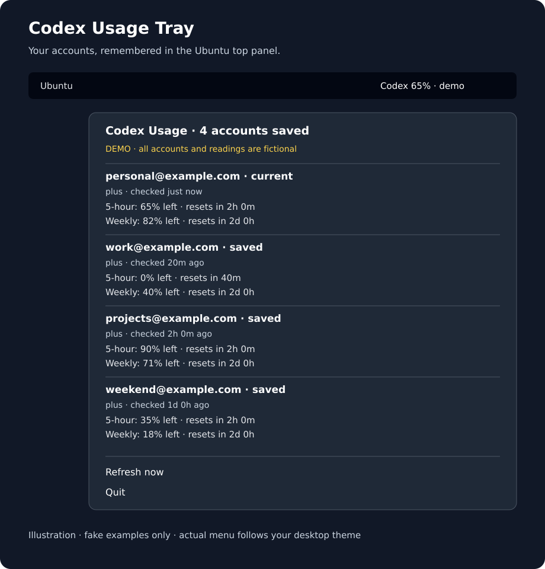

# Codex Usage Tray

**Remember which Codex account still has usage left—from your Ubuntu top panel.**

Free, open-source, and local. Built after repeatedly switching accounts and forgetting which one still had capacity.



*Illustration using fake accounts and sample readings. The native menu follows your desktop theme.*

## What it does

- Shows remaining five-hour and weekly usage when those windows are provided by Codex.
- Remembers accounts and workspaces as you sign into them.
- Keeps the menu compact with a summary for each account. Open an account submenu for reset times and the last check time.
- Refreshes the signed-in account every minute, with a manual **Refresh now** action.
- Shows when each account was last checked, plus reset countdowns.
- Runs in the system tray; no browser dashboard or extra account registration.
- Uses your existing Codex sign-in through its local app-server interface.

**Only the signed-in account refreshes. Other accounts show their last saved reading.** Sign into an account and refresh to verify its current allowance. After an exhausted usage window passes its reset time, the account is highlighted as **likely available** if its other saved windows have capacity. This is an estimate until that account is signed in and refreshed. A weekly limit that is still exhausted prevents the estimate. Other expired readings request a fresh check. This app does not switch accounts or increase usage limits.

## Compatibility

Beta, tested on Ubuntu 24.04 with GNOME's AppIndicator extension and Codex CLI/app-server 0.169.0. Other Linux desktops and Codex versions are not yet verified. Ubuntu is the only platform maintained and released by this project.

The tray needs the **Codex CLI** available as `codex` on your PATH or at `~/.local/bin/codex`, with a ChatGPT account signed in. Install the CLI using the [official Codex instructions](https://developers.openai.com/codex/cli/). Desktop-only installations may need the CLI installed separately. If the CLI and desktop app use different account profiles or `CODEX_HOME` directories, the tray follows the CLI's account.

## Install on Ubuntu

Download and extract the source ZIP from this GitHub repository, then open a terminal inside the extracted folder.

On Ubuntu, install the system dependencies if needed:

```bash
sudo apt update
sudo apt install python3 python3-gi gir1.2-gtk-3.0 libayatana-appindicator3-1
```

The standard Ubuntu desktop normally includes AppIndicator support. Other GNOME installations may need the AppIndicator extension enabled.

Install for your user:

```bash
/usr/bin/python3 install.py
```

Or also enable startup at login:

```bash
/usr/bin/python3 install.py --autostart
```

Launch **Codex Usage Tray** from Ubuntu's applications menu. The install script does not need sudo. Quit an older tray instance before launching an updated version.

## Add your accounts

1. Sign into your first account in Codex.
2. Click the tray icon and **Refresh now**, or wait up to a minute.
3. Repeat for each account you use.

Your account appears automatically. There is no four-account limit. Your existing Codex sign-in handles authentication.

## Demo with fake accounts

```bash
/usr/bin/python3 tray.py --demo
```

Demo mode uses only `personal@example.com`, `work@example.com`, `projects@example.com`, and `weekend@example.com`. It does not start Codex, read your account history, or save demo readings to it. It can run beside the real tray and is explicitly labelled **demo**. Use it for screenshots or demos instead of exposing real account emails.

For fictional JSON examples without a graphical session:

```bash
/usr/bin/python3 tray.py --demo --check
```

## Privacy

The tracker does not directly read, copy, or store your authentication tokens or passwords. It asks a separate, short-lived `codex app-server` process for account and usage information. Codex itself uses its normal authenticated connection to OpenAI, and manages its own credentials.

The tray saves emails, workspace names, account identifiers, plans, usage readings, and check times locally in `~/.local/state/codex-usage-tray/accounts.json` (or under `$XDG_STATE_HOME`). On Linux and macOS, history files use owner-only permissions. On Windows, history is kept under your user profile’s Local AppData. On macOS it is kept under your user Library’s Application Support. There is no tracker backend, analytics, or telemetry in this project. Codex's own settings still apply to Codex processes.

Real account emails are visible in the live menu. Use demo mode for public screenshots. **Forget saved accounts** clears the history; the current account returns on the next refresh.

This project is independently developed and is not affiliated with or endorsed by OpenAI.

## Troubleshooting

- **No tray icon:** enable your desktop's AppIndicator/status notifier support.
- **No usage:** confirm `codex` is installed and signed into a ChatGPT account. API-key usage is not supported by this tracker.
- **Wrong account:** compare the CLI's signed-in account with the desktop app; check whether they use different profiles.
- **Old readings:** only the current account refreshes. Sign into the saved account and click **Refresh now**.
- **A Codex update broke refresh:** the app-server protocol is evolving. Saved readings remain labelled by their check time; report the CLI version and error message without sharing credentials or account files.

Check the connection without printing email addresses:

```bash
/usr/bin/python3 tray.py --check
```

## Uninstall

Choose **Quit** in the tray, then run from this source folder:

```bash
/usr/bin/python3 uninstall.py
```

To also delete saved account readings:

```bash
/usr/bin/python3 uninstall.py --purge
```

## Development

Python standard library + the system's PyGObject/GTK/AppIndicator libraries; no pip dependencies.

```bash
/usr/bin/python3 -m unittest discover -s tests -v
```

Bug reports and contributions are welcome. Include your Ubuntu/desktop version, `codex --version`, and reproduction steps. Do not upload `auth.json`, `accounts.json`, tokens, or unredacted screenshots.

## Community ports

The [macOS Apple Silicon and Windows x64 previews](https://github.com/amoghacloud/codex-usage-tray/releases/tag/v0.2.0) are historical builds. Contributors can fork the repo, test the desktop code, and publish builds under their own signing identity. See [CONTRIBUTING.md](CONTRIBUTING.md) for build and test instructions.

## License

[MIT](LICENSE). Free to use, modify, and share.
